# מצפן תפילה (Tfila Compass) – UX Design

Status: **Implemented** (`js/compass.js`) · Mockups: [mockup.html](mockup.html) · Screenshots: [screenshots/](screenshots/)

## ✅ Decisions

| # | Topic | Decision |
|---|---|---|
| 1 | Entry point | **Option A – floating button, with a text label** "🧭 כיוון תפילה" ([§2](#2-entry-point-option-a--labeled-floating-button)) |
| 2 | Compass style | **3.1 – Classic dial with a Kotel marker** ([§3](#3-compass-screen-31--classic-dial)) |
| 3 | Outside Israel | **Toggle**: "הדרך הקצרה ביותר" (great circle, **default**) / "מנהג: מזרח" (rhumb line). Shown only outside Israel, choice saved |
| 4 | Target point | **Kodesh HaKodashim / Even HaShtiya – 31.7780° N, 35.2354° E**, in line with the Sephardic tradition behind the אור החיים luach ([§1.1](#11-target-point--decision-4)) |
| 5 | Other states | Jerusalem mode, near-Kotel (< 500 m), iOS permission, no-sensor fallback – **all approved** |

> All screenshots are static mockups rendered with the app's real `css/styles.css` (390×844, iPhone size).
> Times and dates are sample data. The green dashed outline only marks the new element; it isn't part of the design.

---

## 1. Halachic check: is the direction right?

**Mostly right. The rule is a bit more exact than "Kotel in Jerusalem, Jerusalem everywhere else."**

Source: Berachot 30a and **Shulchan Aruch, Orach Chaim 94:1**:

| Where the user is | Faces toward |
|---|---|
| Outside Eretz Yisrael | Eretz Yisrael, and through it Jerusalem and the Mikdash |
| In Eretz Yisrael | Jerusalem, and through it the Mikdash |
| In Jerusalem | The Mikdash (Beit HaMikdash / Kodesh HaKodashim) |

What this means for the app:

1. **There is one target point: the Temple Mount (מקום המקדש).** The Kotel stands in for it. Every place on earth that faces the Temple Mount is also facing Jerusalem and Eretz Yisrael. One calculation covers all three cases. Only the **label** changes:
   - Outside Israel: "לעבר ארץ ישראל וירושלים" (toward Eretz Yisrael and Jerusalem)
   - In Israel: "לעבר ירושלים והר הבית" (toward Jerusalem and the Temple Mount)
   - In Jerusalem: "לעבר הכותל המערבי והר הבית" (toward the Western Wall and the Temple Mount)
   - Target: **31.7780° N, 35.2354° E** (Even HaShtiya). See [§1.1](#11-target-point--decision-4).
2. **Close to the Kotel, an arrow is the wrong tool.** From the Kotel plaza, the Temple Mount point is at about 30° (NE), but people pray facing the wall (east). Phone compasses also have about ±5–15° of error. **Under about 500 m, show "פנה אל הכותל / אל הר הבית" ("face the Kotel / the Temple Mount") instead of an arrow.** See [§3.4](#34-next-to-the-kotel--500-m).
3. **Outside Israel, the poskim disagree on how to compute the direction:**
   - *Great circle* (shortest path on the globe): New York → **54° (NE)**, Los Angeles → **24°**
   - *Rhumb line / "Mizrach" custom*: New York → **96° (E)**, Los Angeles → **91°**
   - In North America the common custom is to face **east**, and some poskim rely on the great-circle direction.
   - **Decision:** a toggle that appears only outside Israel. Great circle is the default; "מנהג: מזרח" ("Custom: east") is the alternative. See [§3.3](#33-outside-israel--custom-toggle).
4. Shulchan Aruch OC 94: if the direction can't be determined, one "directs the heart to his Father in Heaven." The app should keep showing its existing disclaimer ("יש להתייעץ עם רב", "consult a rav").

### 1.1 Target point – decision 4

The app already follows the **אור החיים** luach for zmanim: visible sunrise per בכורי יוסף and sunset from the city's highest point (see `getOhrHachaimAdjustments()` in `js/api.js`). That luach is a **zmanim calendar** and doesn't publish a prayer-direction coordinate. So the target follows the halachic tradition it rests on: Shulchan Aruch OC 94 as ruled by the Sephardic poskim. In Jerusalem, one faces the **place of the Kodesh HaKodashim**, not just the Kotel wall.

| | Value |
|---|---|
| Target | Even HaShtiya / Kodesh HaKodashim |
| Coordinates | **31.7780° N, 35.2354° E** |
| Kotel prayer area (used only for the < 500 m state) | 31.7767° N, 35.2345° E |

> ⚠️ I couldn't find a coordinate published by the אור החיים luach itself. Please confirm this point with the luach's editors or your rav before release. Changing it is a one-line constant.

Sample bearings to the Temple Mount (great circle):

| Location | Bearing | Distance |
|---|---|---|
| Tel Aviv | 129° (SE) | 55 km |
| Haifa | 168° (S) | 115 km |
| Eilat | 6° (N) | 248 km |
| Jerusalem – Rehavia | 78° (E) | 2.4 km |
| Jerusalem – Ramot | 137° (SE) | 5.4 km |
| London | 114° (great circle) / 127° (rhumb line) | 3,610 km |
| New York | 54° (great circle) / 96° (rhumb line) | 9,170 km |

---

## 2. Entry point: Option A – labeled floating button

| Dark | Light |
|---|---|
| 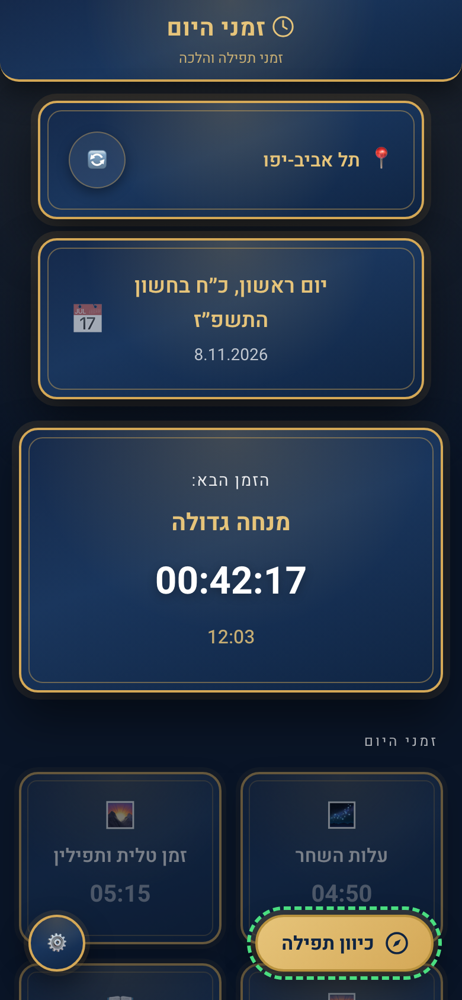 | 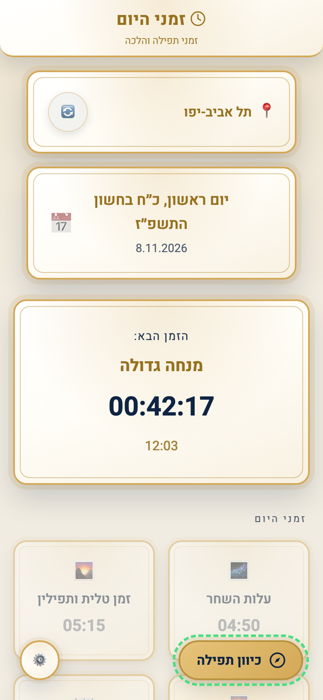 |

An icon alone wasn't clear enough, so the button is now an **extended pill with a label**:

- **Content:** compass icon + **"כיוון תפילה"** ("Prayer direction"). The label is always visible.
- **Style:** solid gold fill with navy text. It's the main action, so it stands out from the outlined ⚙️ Settings button.
- **Position:** fixed at the bottom right (the start side in RTL); ⚙️ stays bottom left. Height 48 px (touch-friendly), safe-area aware like `.btn-settings`.
- **Layout:** add bottom padding to `.main-content` so the last cards can scroll out from under the button.
- **Accessibility:** a real `<button>` whose visible text is its accessible name. Navy text on the gold fill must reach ≥ 4.5:1 contrast in both themes.
- Tapping opens the compass bottom sheet ([§3](#3-compass-screen-31--classic-dial)).

---

## 3. Compass screen: 3.1 – Classic dial

Opens in the app's existing bottom-sheet modal (same as Settings and Location).

| Turning | Aligned |
|---|---|
| 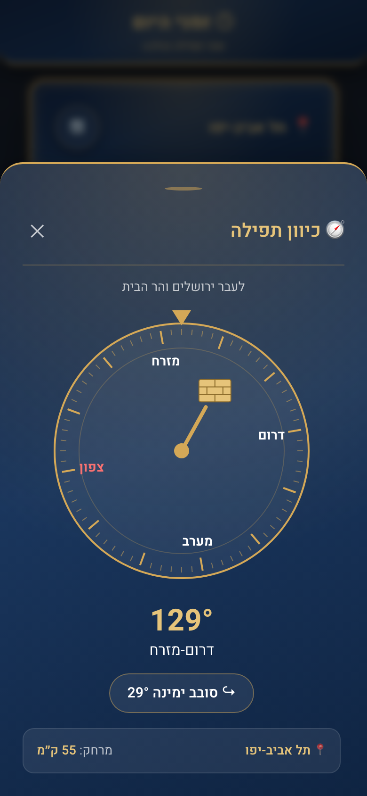 | 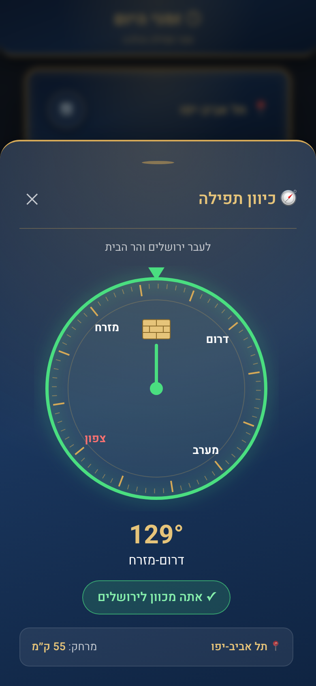 |

- The dial rotates with the phone. A Kotel-stone marker sits at the target bearing, and the gold notch at the top is the direction the phone is pointing.
- When the marker reaches the notch (within ±5°): the ring turns green, the text changes to "✓ אתה מכוון לירושלים" ("✓ You're facing Jerusalem"), and the phone vibrates once (`navigator.vibrate`).
- Below the dial: bearing in degrees, cardinal direction in Hebrew, a turn hint ("סובב ימינה 29°", "Turn right 29°"), and the current location with distance to the target.

Light theme:<br>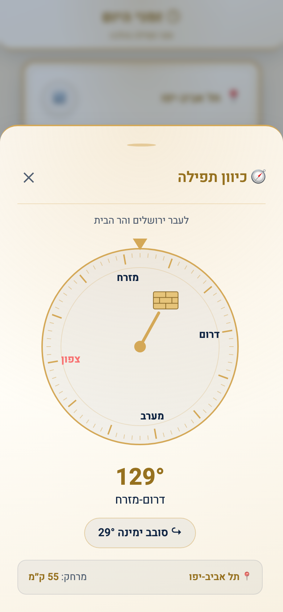

### 3.2 Jerusalem mode
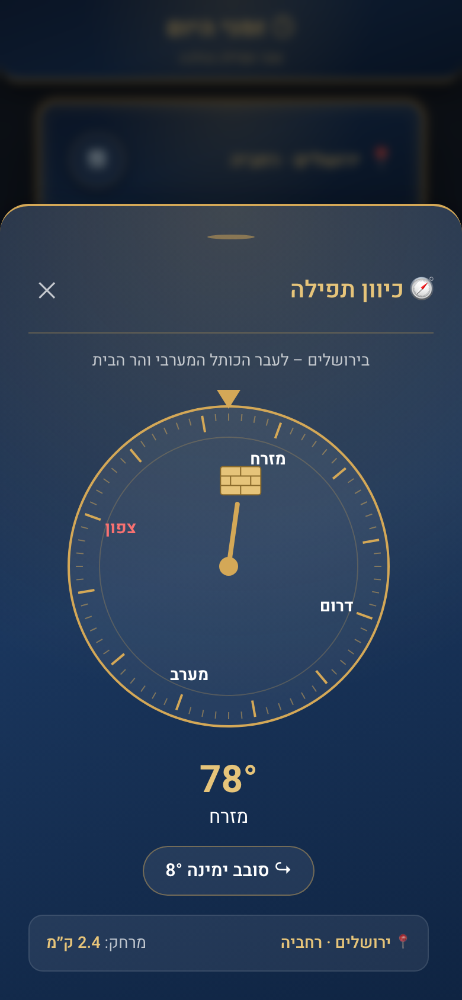

Same dial. The subtitle changes to "בירושלים – לעבר הכותל המערבי והר הבית" ("In Jerusalem – toward the Western Wall and the Temple Mount").

### 3.3 Outside Israel – custom toggle
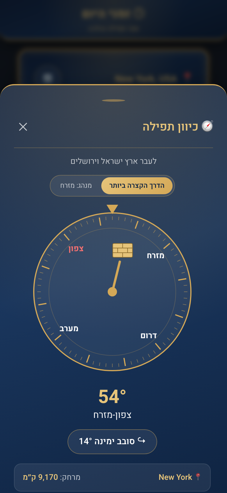

The switch toggles between "הדרך הקצרה ביותר" ("Shortest path", great circle, **default**) and "מנהג: מזרח" ("Custom: east", rhumb line). It only appears outside Israel, and the choice is saved in `localStorage`.

### 3.4 Next to the Kotel (< 500 m)
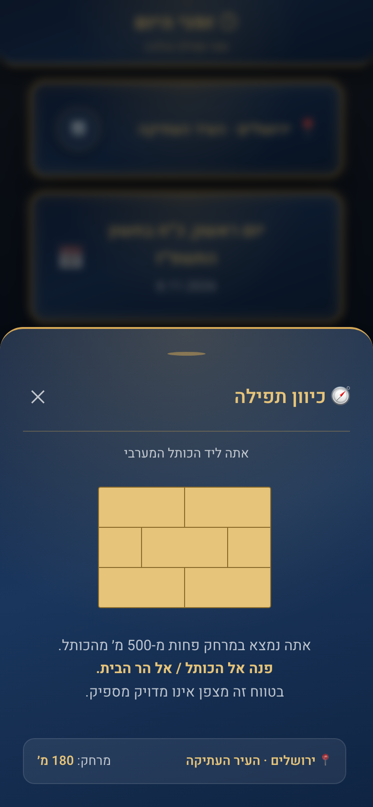

### 3.5 Permission request (iOS needs a user tap)


### 3.6 No compass sensor (desktop / denied)
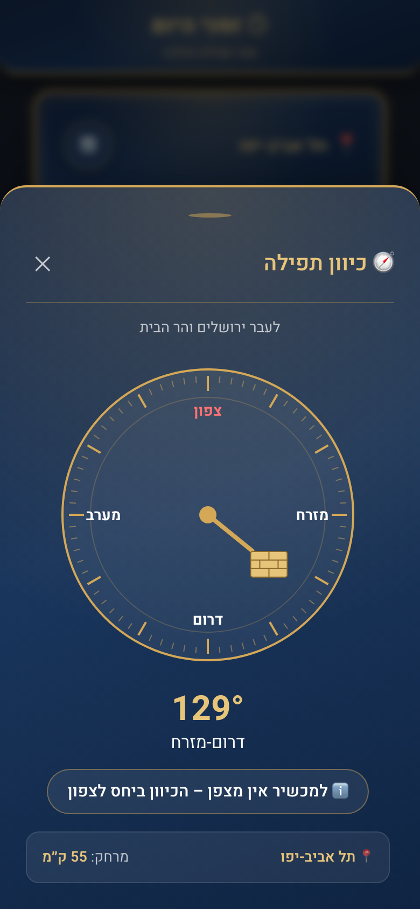

The dial is fixed with north up, and the needle shows the bearing.

---

## 4. Technical notes (for implementation)

- **Bearing:** great-circle formula (default) from `location.latitude/longitude`, which the app already has, to **31.7780, 35.2354**. A rhumb-line formula is needed only for the "מנהג: מזרח" ("Custom: east") option.
- **Heading:**
  - iOS: `DeviceOrientationEvent.requestPermission()` must be called from a tap. Then use `event.webkitCompassHeading`.
  - Android/Chrome: use the `deviceorientationabsolute` event with `heading = 360 - alpha`.
  - Smooth the readings with a low-pass filter so the needle doesn't jitter.
- **True vs. magnetic north:** the browser reading may be magnetic. In Israel the difference is about 5° E, and in New York about 13° W. This needs a declination correction, or a note that the compass reads magnetic north.
- **HTTPS is required.** The PWA already runs on HTTPS.
- **Jerusalem detection:** `isJerusalemArea()` already exists in `js/api.js`. Use distance to the target for the < 500 m state.
- **Accessibility:** add `aria-live` text such as "סובב ימינה 29 מעלות" ("Turn right 29 degrees"), plus vibration on alignment. Labels and color must meet contrast requirements in both themes.

- **Jerusalem bounds:** `isJerusalemArea()` caps longitude at 35.25, which covers the Old City (35.2354), so it's fine for the Jerusalem label.

---

## Appendix – Options considered (not chosen)

<details>
<summary>Entry points B, C, D and compass styles 3.2 Arrow, 3.3 Tape</summary>

| B – Location panel icon | C – Header icon | D – Live card |
|---|---|---|
| 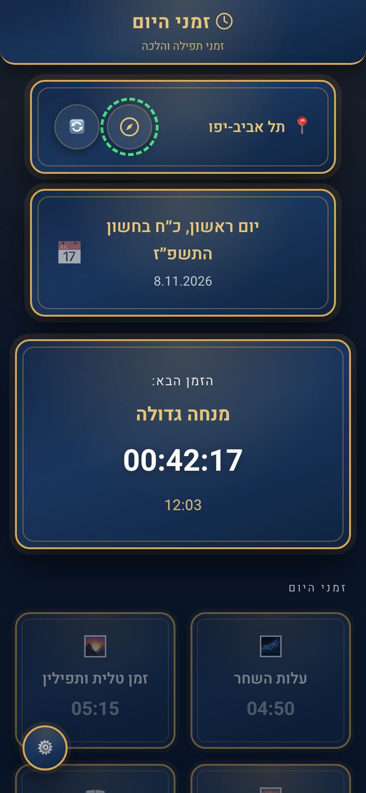 | 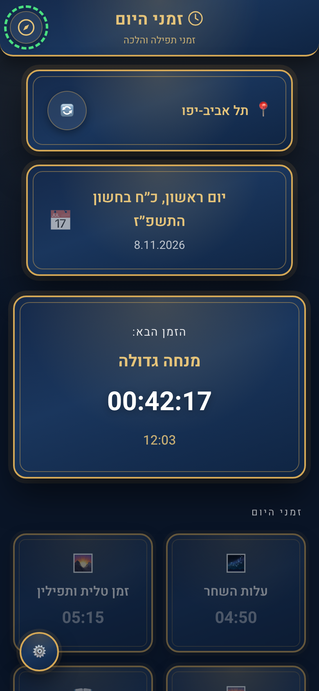 | 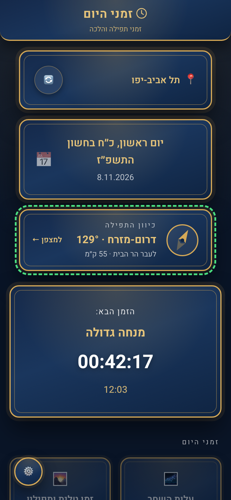 |

| 3.2 Big arrow | 3.3 Horizon tape |
|---|---|
| 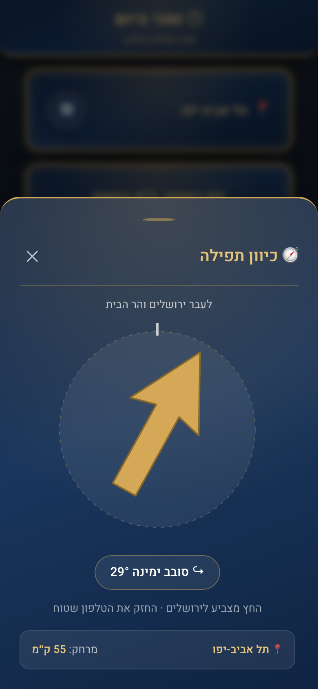 | 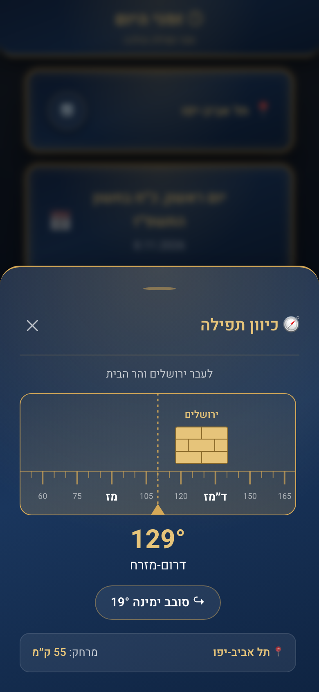 |

</details>

---

### Regenerating the screenshots
```bash
cd docs/tfila-compass
"/Applications/Google Chrome.app/Contents/MacOS/Google Chrome" --headless=new --hide-scrollbars \
  --window-size=390,844 --force-device-scale-factor=2 --virtual-time-budget=4000 \
  --screenshot="$PWD/screenshots/main-a.png" "file://$PWD/mockup.html?s=main-a"
```
Available screens (`?s=`): `main-a|b|c|d`, `compass-dial`, `compass-dial-aligned`, `compass-arrow`, `compass-tape`, `compass-jerusalem`, `compass-near-kotel`, `compass-permission`, `compass-no-sensor`, `compass-diaspora`. Add `&theme=light` for the light theme.
